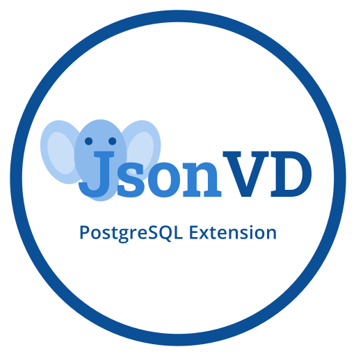

<p align="center"></p>

# jsonvd

[](https://github.com/vladeParica/jsonvd/actions/workflows/ci.yml)
[](https://github.com/vladeParica/jsonvd/releases/latest)
[](docs/00-project/adr/0010-track-upstream-supported-postgresql-versions.md)
[](LICENSE)

JSONB utilities PostgreSQL does not ship with: **find where a value is**, **diff** two documents,
**deep merge** / JSON Merge Patch, and **infer types and schemas** from JSON. Pure SQL, PostgreSQL 14–18.

## Install

```bash
git clone https://github.com/vladeParica/jsonvd && cd jsonvd
make install
```
```sql
CREATE EXTENSION jsonvd;
```

## Example

```sql
SELECT jsonvd.find_path('{"a":[1,{"b":"x"}]}', '"x"');           -- {a,1,b}
SELECT * FROM jsonvd.diff('{"a":1,"b":2}', '{"a":1,"b":3,"c":4}'); -- {b} replace 2 3 / {c} add 4
SELECT jsonvd.merge_deep('{"db":{"host":"h","port":1}}', '{"db":{"port":2}}');
SELECT jsonvd.recordset_definition('[{"id":1,"name":"x"}]');      -- id bigint, name text
```

## Documentation

- [Function reference](docs/02-design/api-contracts.md)
- [Install, upgrade and release](docs/05-deployment/deploy-guide.md) · [Migrating from the legacy `*VD` procedures](docs/05-deployment/migration-from-legacy.md)
- [Project docs](docs/) — charter, requirements, design, ADRs, tests ([AI-DLC](.ai-dlc/))
- [Contributing](CONTRIBUTING.md) · [Code of conduct](CODE_OF_CONDUCT.md) · [Security](SECURITY.md) · [Changelog](CHANGELOG.md)

## License

[MIT](LICENSE) © Vlade Párica
