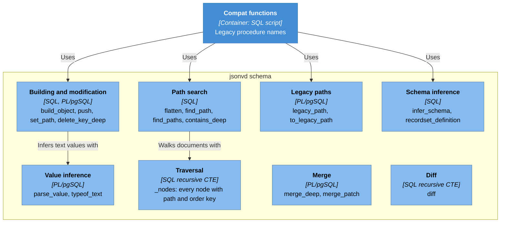

# C4 — Component diagram: jsonvd schema

> **AI-DLC phase:** `02-design`  ·  Level 3 (components inside a container).
> Drawn as a Mermaid flowchart with C4 styling (see the note in `c4-context.md`).

## Rules / behavior
1. Every function is pure: same input, same output; no table access ([ADR-0006](../00-project/adr/0006-immutable-functions-without-pinned-search-path.md)).
2. No component builds SQL from values ([ADR-0003](../00-project/adr/0003-no-dynamic-sql-and-raised-errors.md)).
3. Traversal returns nodes in document order; search functions inherit that order.
4. Legacy paths follow the last-step rule ([ADR-0005](../00-project/adr/0005-preserve-legacy-path-semantics-with-a-separate-compat-layer.md)).
5. The compat layer also uses value inference directly; merge and diff have no internal dependencies.
