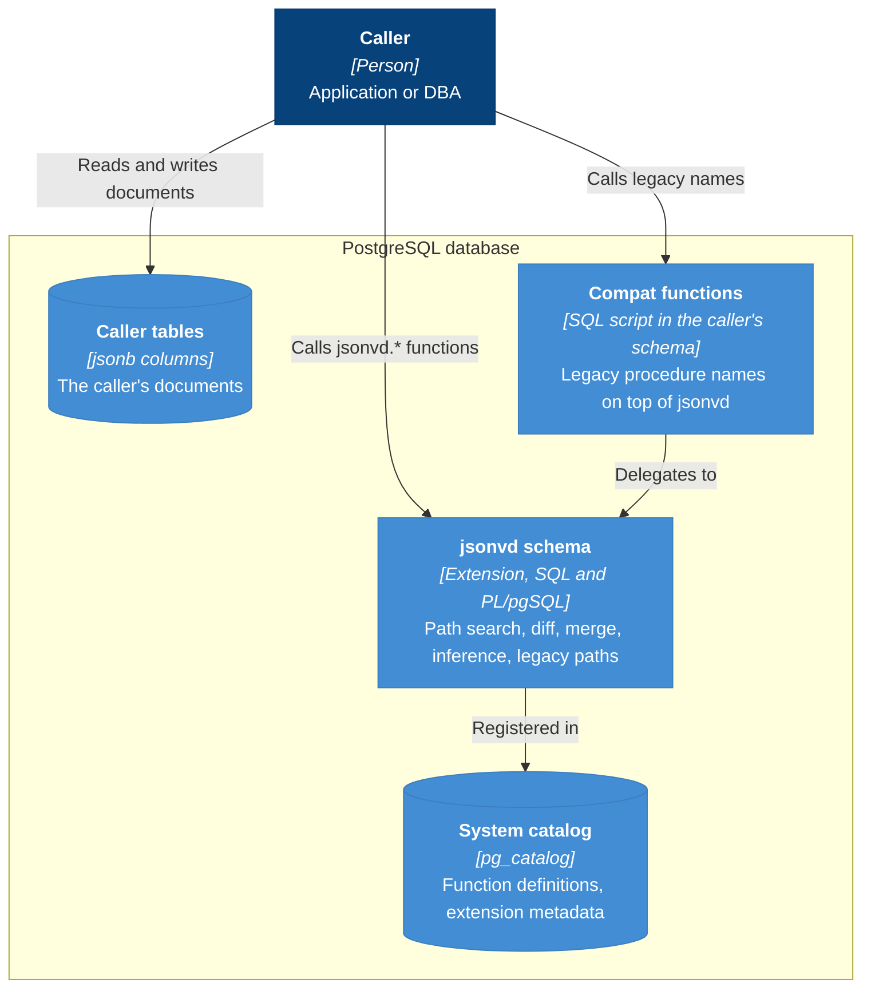

# C4 — Container diagram

> **AI-DLC phase:** `02-design`  ·  Level 2 (containers inside the system).
> Drawn as a Mermaid flowchart with C4 styling (see the note in `c4-context.md`).

**Notes**
- The extension never reads or writes tables: documents reach it only as arguments.
- The compat functions are created by a plain script, so they are not part of the extension and are not
  removed by `DROP EXTENSION jsonvd` ([ADR-0005](../00-project/adr/0005-preserve-legacy-path-semantics-with-a-separate-compat-layer.md)).
