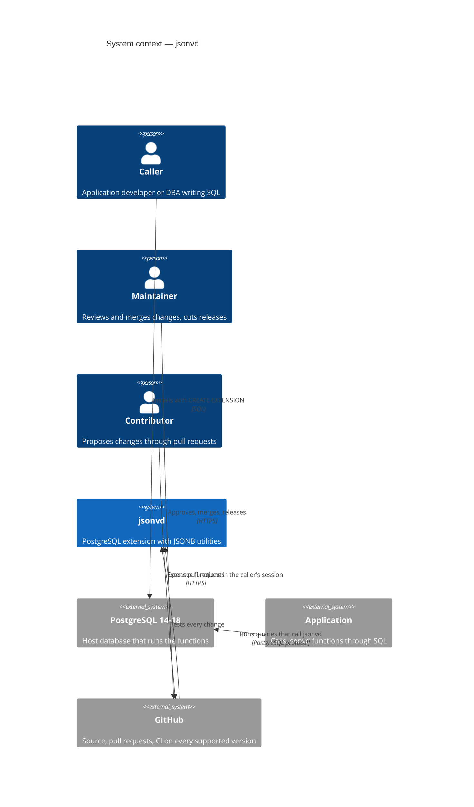

# C4 — Context diagram

> **AI-DLC phase:** `02-design`  ·  Level 1 (the system in its environment).

**Notes**
- jsonvd has no runtime of its own: it exists only as functions inside the host database.
- The only trust boundary that matters at runtime is the caller's database session; at development time it
  is GitHub, where only the maintainer can merge ([ADR-0008](../00-project/adr/0008-repository-governance-and-licensing.md)).
